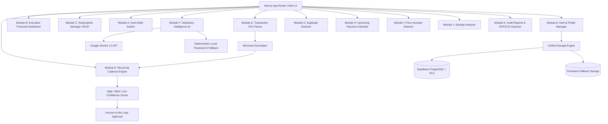

# SubSentry AI – Personal Subscription & Auto-Debit Auditor

<div align="center">


**An intelligent personal finance auditing platform designed to discover, track, analyze, and optimize all recurring commitments, UPI AutoPay mandates, and subscriptions from one centralized dashboard.**

[](https://nextjs.org/)
[](https://www.typescriptlang.org/)
[](https://tailwindcss.com/)
[](LICENSE)
[](tests/)

</div>

---

## 1. Executive Product Architecture

SubSentry AI bridges the gap between fragmented bank statements, card networks, and UPI AutoPay apps (PhonePe, Google Pay, BHIM). It provides an authoritative financial ledger that answers:
- **Where is my money going every month?**
- **Which subscriptions have I forgotten?**
- **What automatic deductions are scheduled next?**
- **Are there duplicate subscriptions leaking money?**
- **Have any subscription prices silently increased?**
- **How much can I save by cancelling unnecessary recurring commitments?**



---

## 2. Technology Stack

- **Frontend:** Next.js 14 App Router, React 18, TypeScript, Tailwind CSS, Lucide Icons, Recharts
- **Design Tokens:** Dark Mode palette (`#0B1020` base, `#151C2F` surface, `#6366F1` indigo, `#06B6D4` cyan, `#22C55E` success, `#F59E0B` warning, `#EF4444` danger)
- **Backend:** Next.js Server API Routes, TypeScript, Zod validation
- **Database & RLS:** PostgreSQL Schema with Supabase Row Level Security (RLS) migrations
- **AI Intelligence:** Google Gemini API integration with strict deterministic mathematical grounding + built-in local heuristics reasoning fallback
- **Parsers & Utilities:** PapaParse CSV parser (HDFC, ICICI, SBI, Axis, and Generic formats), date-fns

---

## 3. Indian Fintech & Security Specifications

SubSentry AI is built specifically around the nuances of the Indian banking and payment ecosystem:
- **Currency Support:** High-precision Indian Rupee (`₹` INR) formatting with Lakhs and Crores numbering conventions, plus USD (`$`), EUR (`€`), and GBP (`£`).
- **RBI e-Mandate Framework Awareness:** Tracks UPI AutoPay mandates (Google Pay, PhonePe, Paytm, BHIM), Credit/Debit Card Standing Instructions (SI), and NACH/ACH direct debits.
- **Zero Credential Storage:** SubSentry AI **never** asks for, collects, or stores net banking passwords, OTPs, UPI PINs, or card CVVs.
- **Account Aggregator (AA) Architecture:** Cleanly separated architecture ready for RBI-licensed Account Aggregators (Sahamati, Setu, OneMoney).

---

## 4. Application Modules

### Module A: Authentication & User Profiles
- User registration, login, logout, password reset flow
- 1-Click Instant Demo Sandbox access
- User profiles with currency preferences (₹ INR default), timezones, and monthly budget caps
- Complete user data isolation

### Module B: Main Financial Dashboard
- Total monthly recurring expenditure (normalized)
- Total annual recurring run-rate
- Active commitments count (subscriptions + mandates)
- Upcoming debits and renewals tracker
- Interactive Recharts: Monthly Spending Trajectory (Bar) and Category Distribution (Pie)
- Urgent action alerts for price hikes and duplicate leakages

### Module C: Subscription Manager
- Complete CRUD functionality (Create, Read, Update, Delete)
- Rich fields: Name, Provider, Category, Amount, Currency, Frequency, Renewal Date, Payment Instrument, Status
- Search, filter by category and status, sort by price and renewal date
- Cancellation guidance drawer: Direct portal links and step-by-step unsubscription guidance

### Module D: Auto-Debit Auditor
- Monitors recurring deductions: UPI AutoPay mandates, Credit card SI, Debit card SI, Bank standing instructions, Loan EMIs, and Insurance premiums
- Tracks masked mandate URNs (e.g. `MND-***-8821`), debit limits, frequency, and payment sources
- Human-in-the-loop review

### Module E: Transaction Import & Recurring Detection Engine
- Statement CSV Dropzone supporting HDFC Bank, ICICI Bank, State Bank of India (SBI), Axis Bank, and generic CSV formats
- Merchant Normalizer: 100+ patterns for Indian and global services (Netflix, Spotify, Amazon Prime, Hotstar, Swiggy One, Zomato Gold, ChatGPT, Google One, Apple, LIC, Cult.fit, etc.)
- Recurring Detection Algorithm: Evaluates cadence intervals (weekly, monthly, quarterly, annual), amount consistency, and merchant reputation to assign `HIGH`, `MEDIUM`, or `LOW` confidence scores
- Human approval queue: Approve & Convert to Subscription, or Dismiss

### Module F: SubSentry Intelligence AI
- Natural language conversational financial auditor
- Answers queries:
  - *"Analyze my recurring expenses"*
  - *"Which subscriptions cost me the most?"*
  - *"Find subscriptions I might have forgotten"*
  - *"Identify possible duplicate payments"*
  - *"Show my upcoming deductions"*
  - *"How much can I save annually?"*
  - *"Which expenses increased recently?"*
- Grounded strictly in stored ledger data—deterministic financial truth prevents synthetic hallucinations

### Module G: Duplicate Subscription Detector
- Identifies identical merchant subscriptions on different payment instruments
- Flags competing category redundancies (e.g., holding multiple music streaming subscriptions)
- Displays recoverable waste per month and provides one-click resolution

### Module H: Upcoming Payment Calendar
- Interactive monthly grid calendar view with day-level drilldown
- Chronological timeline for the next 14 days
- Reminder indicators: 7 days, 3 days, 1 day, and on debit date

### Module I: Price Increase Detector
- Analyzes historical statement debits against baseline subscription amounts
- Flags sudden fee increases (e.g. YouTube Premium raised from ₹189 to ₹299 = +58%)
- Displays previous amount, new amount, delta amount, and date detected

### Module J: Savings Analyzer
- Explicitly separates **Confirmed Savings** (realized from intentionally cancelled subscriptions) from **Hypothetical Savings** (potential duplicate waste and expiring trials)
- Strategic optimization recommendations (e.g., annual billing switches, mandate limit caps)

### Module K: Reports & Exports
- Monthly Financial Audit report
- Annual Subscription report
- Category Spending breakdown
- Auto-Debit Mandates ledger
- Browser print/PDF export format (`@media print` optimized) and instant CSV downloads

---

## 5. Database Schema & Migrations

PostgreSQL schema migrations are located in `supabase/migrations/20261117_init_subsentry.sql`:
- `profiles`: User settings, currency, budget cap
- `payment_methods`: Masked cards, UPI IDs, banks
- `subscriptions`: Recurring commitments, frequencies, next renewal dates
- `mandates`: UPI AutoPay URNs, debit caps, payment sources
- `transactions`: Normalized statement ledger
- `recurring_detections`: Algorithmically scored recurring patterns
- `price_changes`: Price spike audit log
- `notifications`: Alerts and reminders
- `user_preferences`: Reminder windows and email thresholds
- `audit_logs`: Security and data mutation audit trail

---

## 6. Installation & Development

### Prerequisites
- Node.js LTS (v20.x or higher)
- npm or pnpm

### Setup
```bash
# Clone or navigate to the project directory
cd c:\devops

# Install dependencies
npm install

# Copy environment variables
cp .env.example .env.local

# Run automated tests
npm test

# Run Next.js in development mode
npm run dev
```

The application will be live at `http://localhost:3000`.

---

## 7. Automated Testing Suite

SubSentry AI comes with a built-in automated test suite covering algorithms, normalizers, and parsers:

```bash
# Execute test suite
npm test
```

### Test Coverage Summary:
- `tests/merchantNormalizer.test.ts`: Bank statement narration parsing for Indian & global merchants
- `tests/recurringDetector.test.ts`: Interval math, amount consistency, and confidence scoring
- `tests/duplicateDetector.test.ts`: Overlapping accounts and cross-instrument conflict detection
- `tests/savingsCalculator.test.ts`: Deterministic monthly/annual run-rate calculations
- `tests/statementParser.test.ts`: Indian bank statement CSV parsing (HDFC, ICICI, SBI)

---

## 8. Environment Variables

Configure in `.env.local`:

```env
# Application URL
NEXT_PUBLIC_APP_URL=http://localhost:3000

# Demo Mode (true enables offline persistent storage & sample realistic Indian banking/OTT data)
NEXT_PUBLIC_DEMO_MODE=true

# Supabase Configuration (Optional - leave empty to use built-in local persistence engine)
NEXT_PUBLIC_SUPABASE_URL=https://your-project.supabase.co
NEXT_PUBLIC_SUPABASE_ANON_KEY=your-anon-key
SUPABASE_SERVICE_ROLE_KEY=your-service-role-key

# Google Gemini API Key (Optional)
# When set, SubSentry Intelligence uses Gemini 1.5 Flash.
# When unset, SubSentry Intelligence operates via its built-in deterministic heuristic reasoning engine.
GEMINI_API_KEY=
GEMINI_MODEL=gemini-1.5-flash

# Salt secret for masking payment identifiers
APP_ENCRYPTION_SECRET=subsentry_super_secure_random_key_32_chars
```

---

## 9. Security & Privacy Limitations

1. **No Direct Banking Passwords:** SubSentry AI operates on statement uploads and manual mandate entry. It will never request credentials, passwords, or PINs.
2. **Account Aggregator Preparedness:** Live bank connectivity must only be activated through authorized, licensed Account Aggregators (Sahamati / Setu / OneMoney) with explicit user consent.
3. **No Automatic Mandate Execution:** Per security design, SubSentry AI does not execute fund transfers or cancel bank mandates autonomously. All actions require user confirmation.

---

## 10. License

MIT License. Built for individuals and developers committed to personal finance transparency and subscription auditing.
